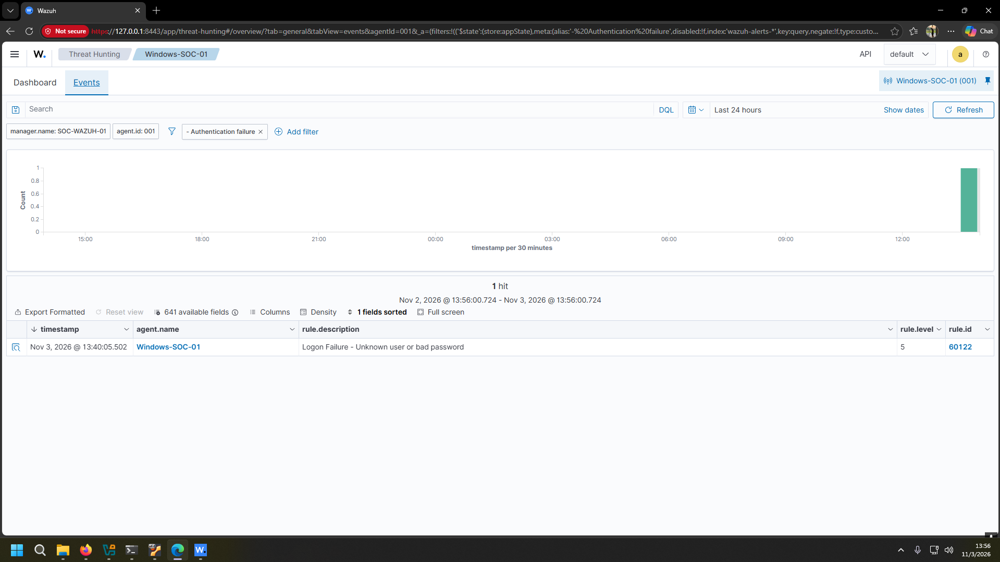
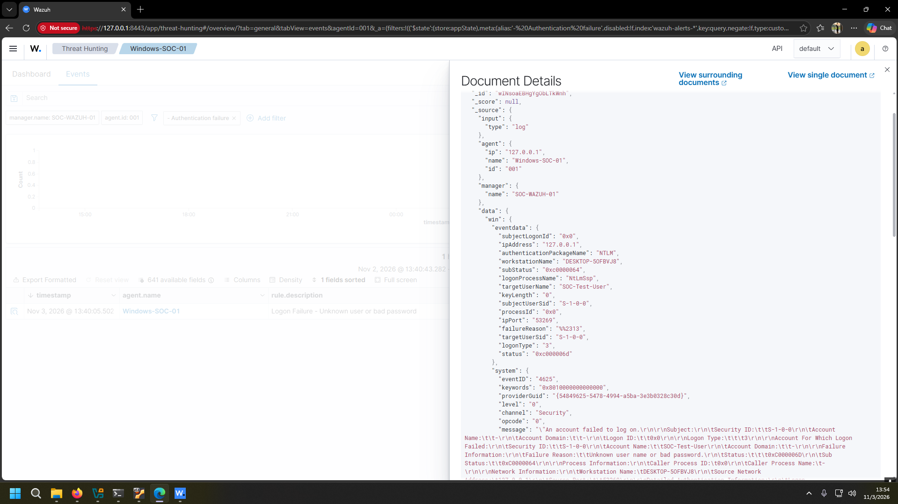

# Detection 001 — Failed Windows Network Logon

**Wazuh SIEM | Windows Event ID 4625 | Authentication Monitoring**

## Overview

This scenario validates the detection of a failed Windows network authentication attempt using a self-hosted Wazuh SIEM running on Ubuntu Server 24.04.5 LTS inside Oracle VirtualBox.

A Windows 11 endpoint monitored by Wazuh Agent 4.14.9 was used to generate and investigate the event.

## Test Execution

A controlled authentication failure was generated using PowerShell:

```powershell
net use \\127.0.0.1\IPC$ /user:SOC-Test-User WrongPassword123!
```

The command attempted to authenticate against the local IPC share using a nonexistent account, resulting in a failed NTLM network logon.

## Detection Results

| Field | Value |
|---|---|
| Windows Event ID | `4625` |
| Wazuh Rule ID | `60122` |
| Alert Severity | `5` |
| Authentication | `NTLM` |
| Logon Type | `3` (Network) |
| Source IP | `127.0.0.1` |
| Target User | `SOC-Test-User` |
| Status | `0xC000006D` |
| Substatus | `0xC0000064` |

### Alert Detection



### Event Details



**Raw evidence:** [event-4625-raw.json](event-4625-raw.json)

## Investigation

The alert was generated by a failed NTLM network authentication attempt originating from the local host.

- **Event ID 4625:** Failed Windows logon.
- **Logon Type 3:** Network authentication attempt.
- **127.0.0.1:** Local loopback address.
- **0xC000006D:** Authentication failure.
- **0xC0000064:** The specified user account does not exist.

Wazuh Rule `60122` successfully identified the event and generated a Level 5 alert.

## Analyst Verdict

**Classification:** True Positive — Authorized Security Test

**Outcome:** Detection successful. The authentication failure was intentionally generated and did not establish unauthorized access.

## Key Takeaways

- Validated Windows Security Event Log collection through Wazuh Agent.
- Investigated a real Windows authentication failure using Wazuh Threat Hunting.
- Interpreted authentication protocols, logon types, and Windows failure codes.
- Confirmed the end-to-end SIEM detection pipeline.
