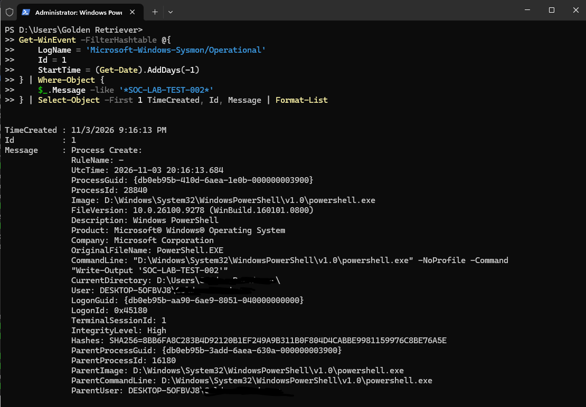
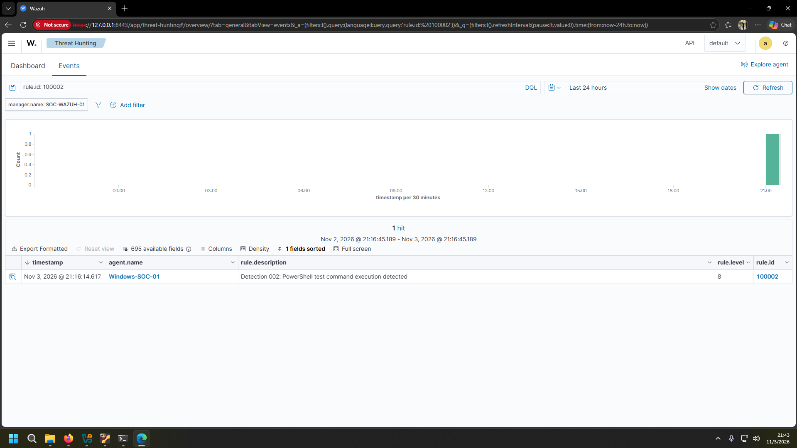
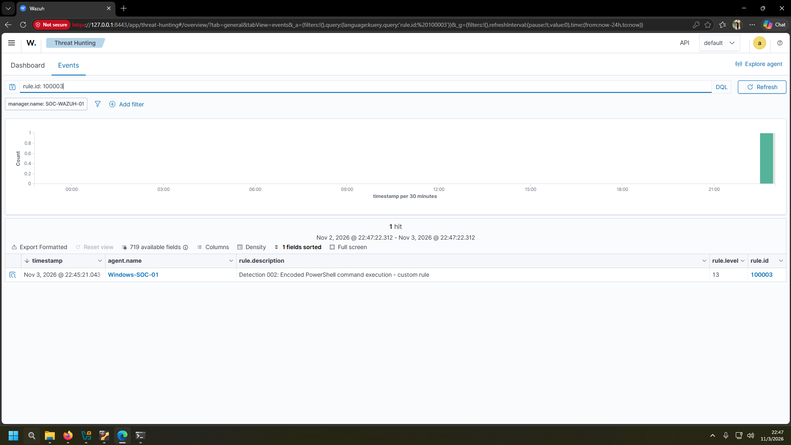
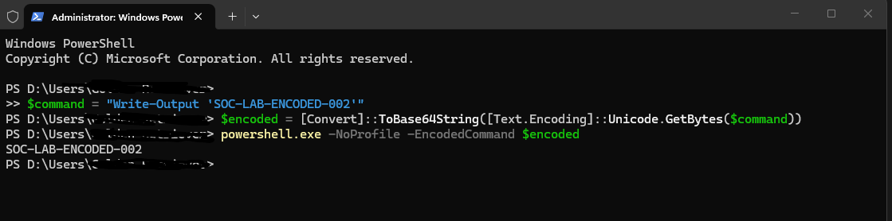
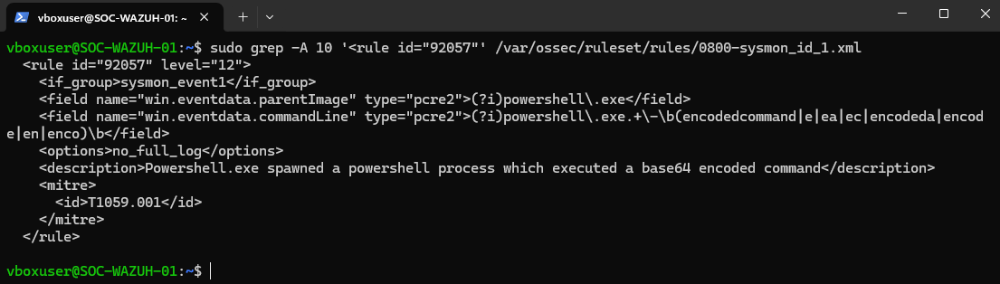
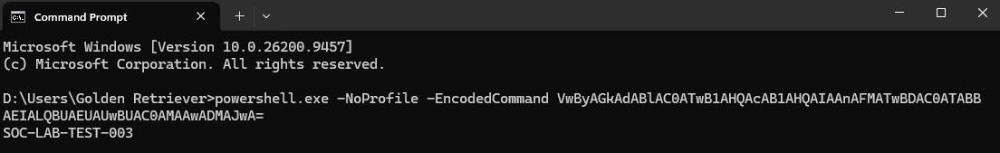
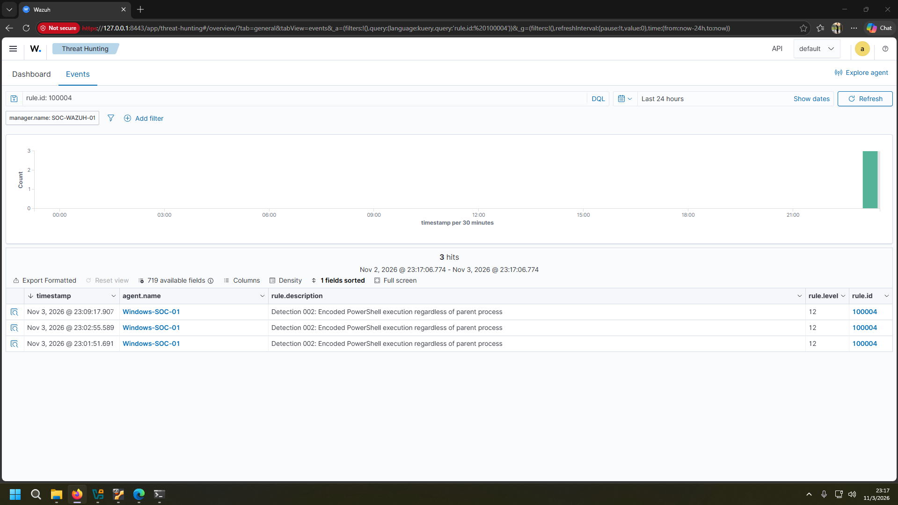

# Detection 002 — PowerShell Execution Monitoring

## Overview

This project demonstrates PowerShell execution monitoring using **Wazuh and Sysmon**, focusing on process creation events, Base64-encoded commands, and custom detection rule development.

The scenario consists of three phases:

1. **Basic Monitoring** — Detecting PowerShell process execution.
2. **Encoded Command Detection** — Identifying Base64-encoded PowerShell commands.
3. **Detection Gap Analysis & Remediation** — Investigating limitations in an existing Wazuh rule and improving detection coverage.

**Key outcome:** Identified a detection coverage limitation in the existing Wazuh ruleset and implemented a custom rule to detect additional encoded PowerShell execution scenarios.

## Lab Environment

| Component | Technology |
|---|---|
| SIEM | Wazuh 4.14 |
| Endpoint | Windows 11 Pro |
| Telemetry | Sysmon — Event ID 1 |
| Wazuh Server | Ubuntu Server 24.04 LTS |
| Virtualization | Oracle VirtualBox |
| MITRE ATT&CK | T1059.001 — PowerShell |

---

## Phase 1 — Basic PowerShell Monitoring

### Objective

Verify PowerShell process creation telemetry and implement a custom detection rule.

### Execution

A controlled PowerShell command was executed:

```powershell
powershell.exe -NoProfile -Command "Write-Output 'SOC-LAB-TEST-002'"
```

Sysmon recorded the process creation event (Event ID 1), which was forwarded to Wazuh for analysis.

Custom rule **100002 (Level 8)** was implemented to identify the test marker within the process command line.

**Result:** Successful detection and alert generation.

### Evidence

**Sysmon Event ID 1 — Process Creation**



**Custom PowerShell Detection**



**Detection artifacts:**

- [Custom Rule 100002](rules/custom-rule-100002.xml)
- [Wazuh Alert 100002](alerts/wazuh-alert-100002.json)

---

## Phase 2 — Encoded PowerShell Execution

### Objective

Detect PowerShell execution using the `-EncodedCommand` argument.

### Execution

A Base64-encoded test command was generated and executed:

```powershell
$command = "Write-Output 'SOC-LAB-ENCODED-002'"
$encoded = [Convert]::ToBase64String(
    [Text.Encoding]::Unicode.GetBytes($command)
)
powershell.exe -NoProfile -EncodedCommand $encoded
```

The execution triggered Wazuh's built-in rule **92057**, which detects encoded PowerShell execution under specific conditions.

Custom rule **100003 (Level 13)** was implemented as a child of rule 92057 to generate a dedicated alert for the tested `-EncodedCommand` pattern.

**Result:** Successful detection with MITRE ATT&CK mapping to **T1059.001 — PowerShell**.

### Evidence

**Encoded PowerShell Execution**



**Custom Encoded Command Alert**



**Detection artifacts:**

- [Custom Rule 100003](rules/custom-rule-100003.xml)
- [Wazuh Alert 100003](alerts/wazuh-alert-100003.json)

---

## Phase 3 — Detection Gap Analysis & Remediation

### Detection Gap Identification

Additional tests were performed to evaluate the detection coverage of the existing Wazuh ruleset.

Analysis of built-in rule **92057** revealed a dependency on the parent process:

```xml
<field name="win.eventdata.parentImage" type="pcre2">(?i)powershell\.exe</field>
```

The rule also used a command-line expression that did not explicitly include the exact `-enc` abbreviation.

During testing, two limitations were observed:

- **PowerShell with `-enc`:** The execution generated a general process alert (`92027`) rather than the expected encoded-command detection.
- **CMD → PowerShell with `-EncodedCommand`:** Sysmon recorded the process creation event, but the expected specialized Wazuh alert was not observed.

These findings indicated limitations in the tested detection coverage. Ingestion of the original CMD event into the Wazuh analysis engine was not independently confirmed.

### Detection Gap Evidence

Analysis of the original Wazuh rule 92057 revealed a parent process dependency, limiting detection coverage for certain encoded PowerShell execution scenarios.

The following screenshot shows the original rule definition, including the `parentImage` and `commandLine` conditions responsible for its detection scope.

**Original Wazuh Rule 92057 — Detection Coverage Limitation**



### Remediation — Custom Rule 100004

To improve detection coverage, custom rule **100004 (Level 12)** was implemented.

Unlike the original rule, the new detection does not require a specific parent process.

It evaluates:

- Sysmon process creation events (Event ID 1).
- PowerShell executable paths.
- The `-EncodedCommand` and `-enc` command-line arguments.

This enables detection of the tested encoded PowerShell executions launched from CMD.

### Validation

A controlled encoded PowerShell command was executed from CMD:

```cmd
powershell.exe -NoProfile -EncodedCommand VwByAGkAdABlAC0ATwB1AHQAcAB1AHQAIAAnAFMATwBDAC0ATABBAEIALQBUAEUAUwBUAC0AMAAwADMAJwA=
```

**Validation results:**

| Test Scenario | Expected Result | Status |
|---|---|---|
| PowerShell → `-EncodedCommand` | Rule 100003 | PASS |
| Normal PowerShell execution | No rule 100003 alert | PASS |
| CMD → `-EncodedCommand` | Rule 100004 | PASS |
| CMD → `-enc` | Rule 100004 | PASS |
| CMD → normal PowerShell | No rule 100004 alert | PASS |

The tests confirmed that rule 100004 detected both tested encoded-command variants launched from CMD without triggering on the tested normal PowerShell execution.

### Remediation Evidence

**CMD-Initiated Encoded PowerShell Execution**



**Successful Detection — Custom Rule 100004**



**Detection artifacts:**

- [Custom Rule 100004](rules/custom-rule-100004.xml)
- [Wazuh Alert 100004](alerts/wazuh-alert-100004.json)

---

## Limitations

- All tests were performed in an isolated lab environment using controlled commands.
- Encoded PowerShell execution is not inherently malicious and may occur during legitimate administrative activity.
- Detection coverage was validated against selected scenarios, not all PowerShell execution methods, argument abbreviations, or evasion techniques.
- Additional tuning and testing would be required before production deployment.

## Key Takeaways

This scenario provided hands-on experience in:

- Windows endpoint telemetry collection using Sysmon.
- Wazuh custom rule development and validation.
- PowerShell execution monitoring.
- MITRE ATT&CK mapping.
- Identifying detection coverage gaps in existing rules.
- Implementing and validating detection improvements.

**Final outcome:** Three custom Wazuh rules developed and tested, including a remediation rule that improved detection coverage for encoded PowerShell execution across the tested scenarios.
